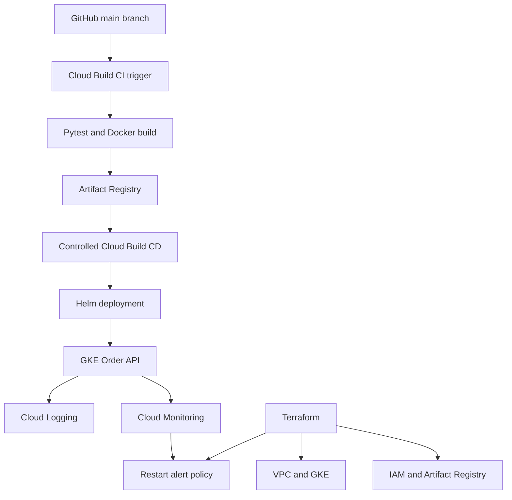

# GCP Enterprise DevOps Platform

An end-to-end Google Cloud DevOps engineering project demonstrating Infrastructure as Code, containerized application delivery, Kubernetes operations, automated CI, controlled CD, and cloud observability.

## Project Overview

The platform deploys a Python FastAPI Order API onto Google Kubernetes Engine (GKE), with infrastructure provisioned through Terraform and application releases managed using Cloud Build and Helm.

The implementation is designed as an enterprise-style learning and portfolio project. It uses selected production-oriented patterns but is not a fully production-hardened system.

**Repository:** [gcp-enterprise-devops-platform](https://github.com/prashanthkamsala/gcp-enterprise-devops-platform)

## Technology Stack

| Area | Technology |
|---|---|
| Cloud | Google Cloud Platform |
| Infrastructure as Code | Terraform |
| Containers | Docker |
| Orchestration | GKE Standard, Kubernetes |
| Application | Python, FastAPI |
| Package management | Helm |
| CI/CD | Google Cloud Build |
| Source control | GitHub |
| Image registry | Artifact Registry |
| Monitoring | Google Cloud Monitoring |
| Logging | Google Cloud Logging |
| Identity and security | Google Cloud IAM, Kubernetes RBAC |

## Architecture



The CI and CD pipelines use separate Google Cloud service accounts. GitHub pushes automatically execute CI, while CD is initiated separately with an explicitly supplied image digest.

## Infrastructure

Terraform provisions the following resources in `us-east1`:

- Custom-mode VPC and regional subnet
- Dedicated primary, Pod, and Service IP ranges
- GKE Standard zonal cluster and node pool
- Artifact Registry Docker repository
- Cloud Build source staging bucket
- Dedicated CI and CD service accounts
- Scoped Google Cloud IAM permissions
- Cloud Monitoring restart alert policy

Terraform state is stored remotely in Google Cloud Storage.

### Network Configuration

| Network | CIDR |
|---|---|
| GKE node subnet | `10.20.0.0/24` |
| Pod secondary range | `10.21.0.0/18` |
| Service secondary range | `10.22.0.0/22` |

The development cluster uses a public GKE control-plane endpoint with authorized network restrictions. This design is for a controlled lab; production deployments should evaluate private control-plane access and more restrictive network policies.

## Application

The Order API is a containerized FastAPI application that provides:

- Liveness and readiness health endpoints
- Order creation
- Order retrieval by ID
- Request validation
- Non-root container execution
- Kubernetes resource requests, limits, and health probes

### API Endpoints

| Method | Endpoint | Purpose |
|---|---|---|
| GET | `/health/live` | Liveness |
| GET | `/health/ready` | Readiness |
| POST | `/orders` | Create an order |
| GET | `/orders/{id}` | Retrieve an order |

**Important limitation:** Orders are stored in application memory. Restarting or replacing the Pod can lose order data. Durable storage is a future improvement.

## Continuous Integration

A GitHub push to `main` triggers the Cloud Build pipeline defined in `cloud-build/cloudbuild.yaml`.

The pipeline:

1. Runs the Python application tests.
2. Builds the Docker container image.
3. Tags the image using the Cloud Build build ID.
4. Publishes the image to a private Artifact Registry repository.

The CI identity has image-publishing permissions but does not receive Kubernetes deployment permissions.

## Continuous Deployment

The deployment pipeline is defined in:

`cloud-build/gke-helm-deploy.yaml`

It:

1. Validates the supplied SHA256 image digest.
2. Authenticates to GKE using a dedicated deployment service account.
3. Validates the Helm chart.
4. Upgrades the Order API release.
5. Waits for Kubernetes rollout completion.
6. Verifies the image digest configured on the Deployment.

A separate `gke-helm-dry-run.yaml` allows simulated upgrade validation.

Kubernetes RBAC restricts the deployment identity to the application namespace. The Helm release requires permission to manage namespaced release metadata.

### Verified Deployment

The deployment was successfully verified with:

- Helm release: `order-api`
- Namespace: `order-platform`
- Helm revision: `4`
- Deployment: `1/1` available
- Pod: `1/1 Running`
- Container restarts: `0`

These represent validation results from October 29, 2026, not a live status guarantee.

## Monitoring and Operations

GKE workload logs are collected through Cloud Logging. Cloud Monitoring provides infrastructure and container metrics.

A Terraform-managed policy monitors increases in the Order API container restart count.

**Alert:** `Order API - Unexpected Container Restarts`

The policy is enabled but has no external notification channel configured. Alert-trigger testing has not yet been performed.

Incident investigation and recovery procedures are documented in:

`docs/runbooks/order-api-incident-response.md`

## Security Approach

- Dedicated service accounts for CI, CD, and GKE nodes
- Scoped Artifact Registry access
- Kubernetes namespace Role and RoleBinding for deployment
- Private image registry
- Container execution as a non-root user
- Immutable image digest deployment
- Remote Terraform state
- No service account key files committed to Git

The lab has known security limitations, including broad Google Cloud public-range access to the GKE control plane. Further network hardening would be required for production.

## Repository Structure

```text
application/order-api/          FastAPI application and tests
cloud-build/                    CI, CD, and dry-run pipelines
docs/architecture/              Architecture decisions and network design
docs/ci-cd/                     CI integration notes
docs/runbooks/                  Deployment and incident procedures
docs/cost-analysis/             Resource cost and cleanup documentation
kubernetes/helm/order-platform/ Helm deployment chart
kubernetes/rbac/                Deployment identity permissions
monitoring/                     Monitoring-related project assets
scripts/                        Operational helper scripts
terraform/environments/dev/     Development environment infrastructure
terraform/modules/              Reusable infrastructure modules
```

## Local Development

Requirements include Python, Docker, Terraform, Google Cloud CLI, kubectl, and Helm.

Install application dependencies:

```bash
python3 -m venv .venv
source .venv/bin/activate
pip install -r application/order-api/requirements-dev.txt
```

Run application tests:

```bash
python -m pytest application/order-api/tests -v
```

Build the container:

```bash
docker build -t order-api:local application/order-api
```

## Kubernetes Verification

After provisioning the infrastructure and configuring appropriate access:

```bash
gcloud container clusters get-credentials devops-lab-gke \
  --zone us-east1-b

kubectl get nodes
kubectl get pods -n order-platform
helm status order-api -n order-platform
```

Test the API through local port forwarding:

```bash
kubectl port-forward -n order-platform svc/order-api 8081:80
```

Then, from a second terminal:

```bash
curl http://127.0.0.1:8081/health/live
curl http://127.0.0.1:8081/health/ready
```

## Project Validation

The following capabilities have been demonstrated:

- Terraform-managed GCP infrastructure
- GKE deployment and application health verification
- Automated GitHub-triggered CI
- Cloud Build image publication
- Cloud Build-controlled Helm deployment
- Post-deployment rollout verification
- Cloud Logging integration
- Terraform-managed restart monitoring
- Operational incident response runbook

## Known Limitations and Future Enhancements

- Add persistent database-backed order storage.
- Use private GKE control-plane access and hardened network connectivity.
- Add automated CD approval and release promotion.
- Add notification channels and test alert delivery.
- Add workload-level service monitoring and SLOs.
- Use pinned, verified CI/CD tooling images.
- Add further automated security and image vulnerability scanning.
- Add disaster recovery and availability testing.

## Cost and Teardown

This project uses billable Google Cloud resources, including GKE infrastructure, logging, monitoring, storage, and Cloud Build services.

For lab shutdown, review the Terraform destroy plan carefully and remove out-of-band resources such as GitHub connections and build triggers.

**Do not delete the Terraform state bucket before infrastructure teardown has been verified.**

## Project Status

Core platform implementation and CI/CD validation completed in October 2026. Final documentation and infrastructure cleanup are handled as separate project closure steps.

## License

No license has been selected for this repository.
